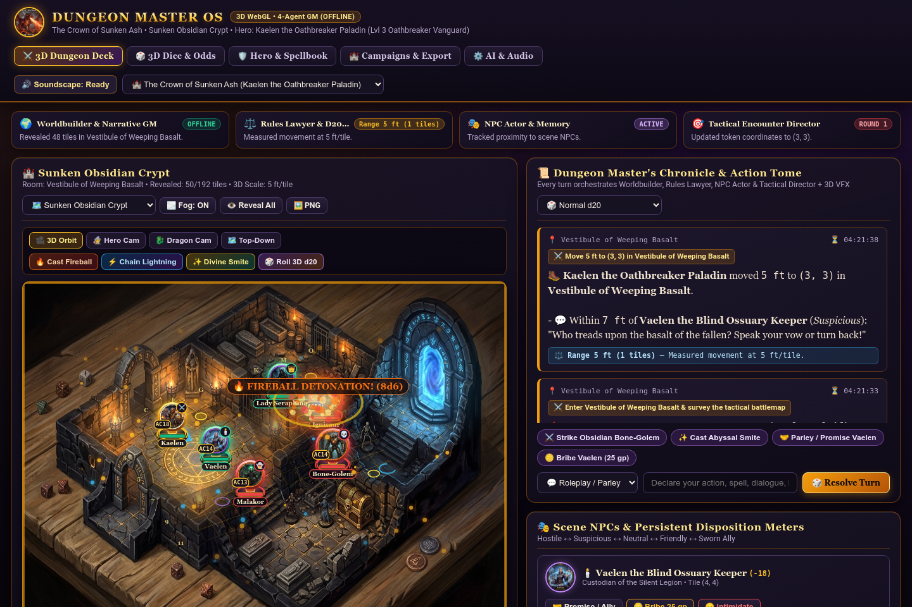
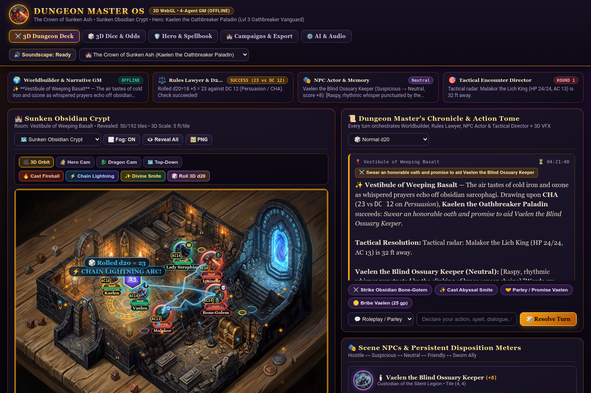
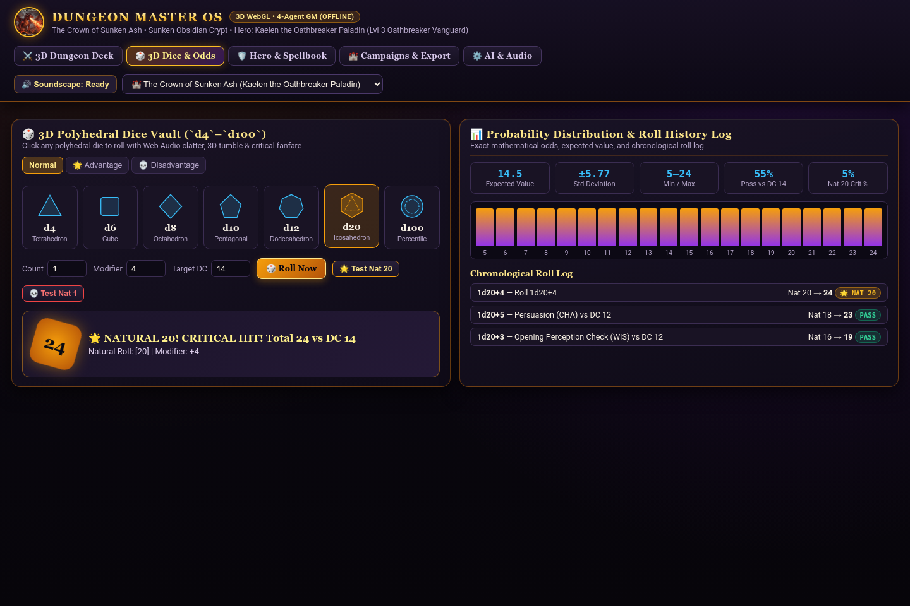
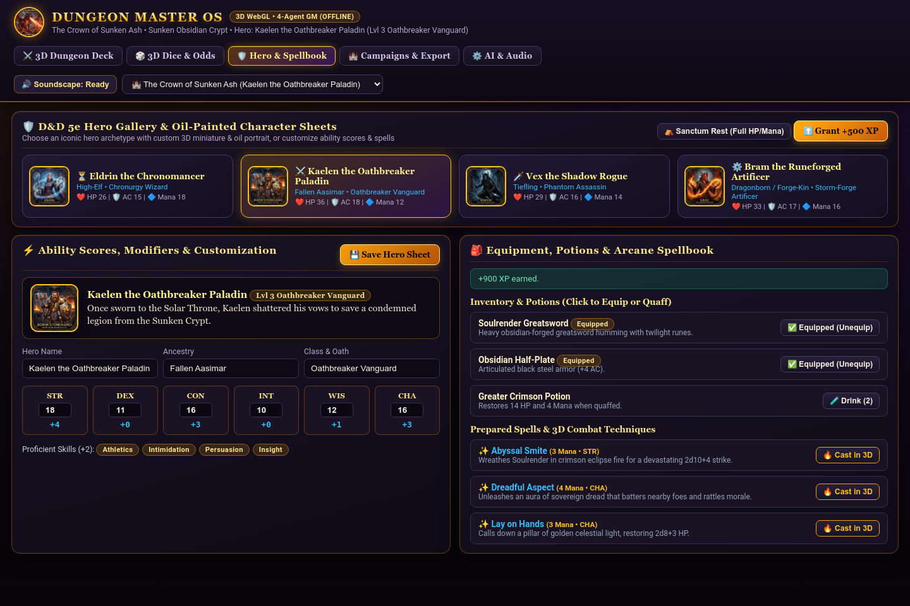
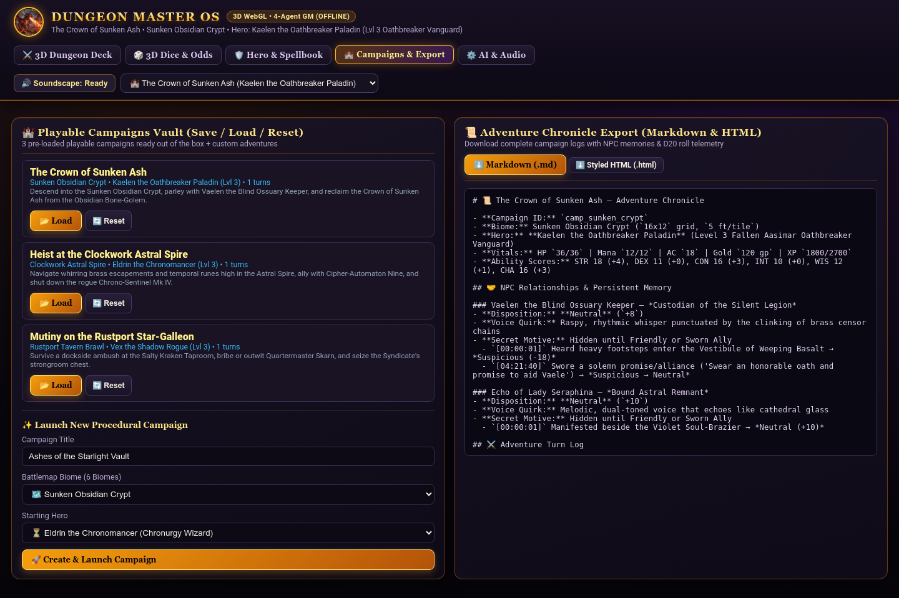
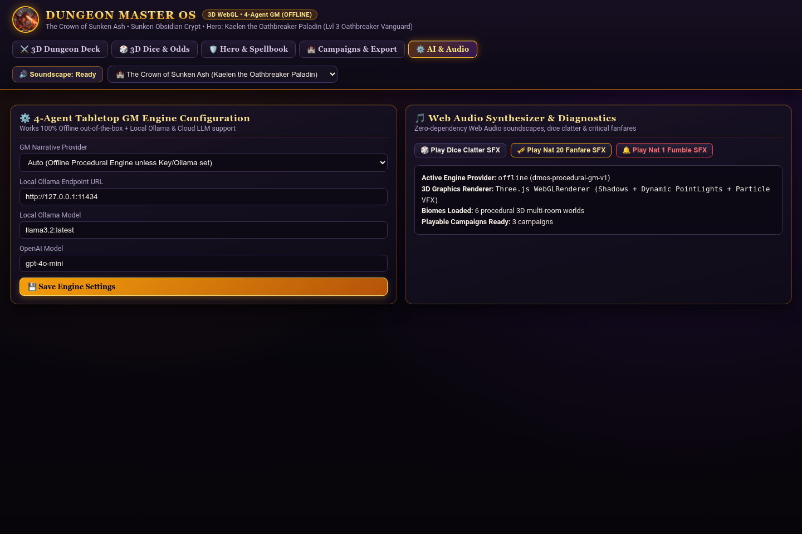

# 🐉 Dungeon Master OS (`dungeon-master-os`)

**Autonomous Solo & Party Tabletop RPG Command Deck & Procedural Battlemap Studio**  
Default Port: **`8093`** (`DMOS_PORT`) • **100% Offline Procedural GM Engine** + **Local Ollama / Cloud LLM Support**



---

## ✨ Core Features & Architecture

### 1. 4-Agent Tabletop GM Engine (`dungeon_master_os/agents.py`)
Every player action, spell, attack, or NPC conversation runs through a coordinated **4-Agent Tabletop GM Pipeline** that works **100% offline out-of-the-box** and optionally connects to **Local Ollama** (`http://127.0.0.1:11434/api/chat`), **OpenAI**, or **Anthropic**:
1. **🌍 Worldbuilder & Narrative GM Agent (`WorldbuilderGMAgent`)**: Sets atmospheric scenes, describes sensory details across 6 biomes, adapts to any player action, and generates contextual tactical/roleplay quick-actions.
2. **⚖️ Rules Lawyer & D20 Mechanics Agent (`RulesLawyerAgent`)**: Automatically classifies actions into Skill Checks, Saving Throws, or Attack Rolls across all 6 ability scores (**`STR`, `DEX`, `CON`, `INT`, `WIS`, `CHA`**), assigns an honest Difficulty Class (**`DC 10`–`DC 20`** or target AC), rolls `d20 + modifier` (with **Normal / Advantage / Disadvantage**), and resolves **Critical Hits (`Nat 20`)** and **Critical Fumbles (`Nat 1`)**.
3. **🎭 NPC Actor Agent with Persistent Relationship Memory (`NPCActorAgent`)**: Every NPC features an emblem portrait, distinct voice quirk, hidden secret motive, persistent memory log, and a 5-stage **Disposition Meter (`Hostile` ↔ `Suspicious` ↔ `Neutral` ↔ `Friendly` ↔ `Sworn Ally`)** that shifts dynamically in response to dialogue, bribes, threats, or sworn oaths. Reaching `Friendly` or `Sworn Ally` unlocks the NPC's secret motive and brings `Sworn Ally` companions into tactical combat alongside the hero.
4. **🎯 Tactical Encounter Director (`TacticalDirectorAgent`)**: Manages turn-based initiative order, monster AI movement & counter-attacks, HP/AC tracking, double-dice critical damage, XP/level-up progression, and loot drops.



---

### 2. Interactive Procedural Battlemap & Fog-of-War Canvas (`dungeon_master_os/battlemap.py`)
- **6 Procedural Multi-Room Biomes (`16×12` grid, `5 ft/tile` = `80 ft × 60 ft`)**:
  1. **Sunken Obsidian Crypt** (`sunken_obsidian_crypt`) — Basalt vaults, violet soul-braziers, necrotic runes & cursed sarcophagi
  2. **Dragon's Ember Cavern** (`dragons_ember_cavern`) — Molten magma channels, scorched bridges & draconic hoard chests
  3. **Clockwork Astral Spire** (`clockwork_astral_spire`) — Interlocking brass escapements, temporal flux glyphs & starlight conduits
  4. **Whispering Feywild Grove** (`whispering_feywild_grove`) — Bioluminescent spore lanterns, rime-ice slicks & sylvan shrines
  5. **Rustport Tavern Brawl** (`rustport_tavern_brawl`) — Lantern-lit oak tables, spilled ale hazards & smuggler strongrooms
  6. **Starship Derelict Deck** (`starship_derelict_deck`) — Airlock bulkheads, ruptured plasma conduits & zero-G cargo bays
- **Interactive Token Movement & Fog of War**: Click any tile or use **WASD / Arrow keys / D-Pad buttons** to move the hero token across the grid, dynamically revealing rooms via Bresenham line-of-sight raycasting, auto-opening doors, looting treasure chests, triggering trap saving throws, and measuring target range in feet (`5 ft/tile`).
- **High-Resolution PNG Battlemap Export**: Download a rendered PNG snapshot of the current tactical map at `/api/campaigns/{id}/battlemap.png`.

---

### 3. 3D/Animated Polyhedral Dice Tray, Hero Builder & Soundscape
- **Full Polyhedral Dice Roller (`d4`, `d6`, `d8`, `d10`, `d12`, `d20`, `d100`)**: Includes Advantage/Disadvantage toggles, custom dice pools & modifiers, target DC pass probability calculation, theoretical probability histogram, chronological roll log, and zero-dependency **Web Audio synthesized dice clatter + Critical Hit (`Nat 20`) brass fanfare**.
- **Hero Builder, Inventory & Spellbook (`dungeon_master_os/heroes.py`)**: Choose or customize 4 iconic heroes:
  - **Eldrin the Chronomancer** (*High-Elf Chronurgy Wizard*)
  - **Kaelen the Oathbreaker Paladin** (*Fallen Aasimar Oathbreaker Vanguard*)
  - **Vex the Shadow Rogue** (*Tiefling Phantom Assassin*)
  - **Bram the Runeforged Artificer** (*Forge-Dwarf Battlesmith Artificer*)
  Equip weapons/armor, quaff healing/mana potions, cast arcane spells, take Sanctum Rests, and level up XP.
- **3 Pre-Loaded Playable Campaigns + Chronicle Export**:
  1. *The Crown of Sunken Ash* (`camp_sunken_crypt`)
  2. *Heist at the Clockwork Astral Spire* (`camp_astral_spire`)
  3. *Mutiny on the Rustport Star-Galleon* (`camp_rustport_brawl`)
  Export any campaign's complete adventure log, NPC memories, and D20 telemetry as **Markdown (`.md`)** or **Standalone Styled HTML (`.html`)**.

| 3D Polyhedral Dice Tray & Odds | Hero Builder & Spellbook |
|---|---|
|  |  |

| Campaigns Vault & Chronicle Export | AI Engine & Web Audio Settings |
|---|---|
|  |  |

---

## 🚀 Quickstart

### One-Command Launch (Port `8093`)
```bash
./run.sh
```
Or run directly with Python (`server.py` and `app.py` auto-inject `.venv` site-packages):
```bash
python3 server.py --port 8093
```
Then open **`http://127.0.0.1:8093`** in your browser.

### Run Diagnostics & Automated Test Suite
```bash
# Run environment, math, and live server health check
.venv/bin/python scripts/selfcheck.py --server http://127.0.0.1:8093

# Run unit, API smoke, and Playwright headless Chromium UI tests
.venv/bin/pytest -v
```

---

## 🔌 REST API Reference

| Endpoint | Method | Description |
|---|---|---|
| `/api/health` | `GET` | Service status, active provider/model, campaigns/biomes/heroes count |
| `/api/catalog` | `GET` | Full catalog of 6 biomes, 4 hero presets, supported dice (`d4`–`d100`), and settings |
| `/api/campaigns` | `GET` / `POST` | List all saved campaigns or create a new procedural campaign |
| `/api/campaigns/{id}` | `GET` | Retrieve full campaign state (battlemap, hero, NPCs, monsters, combat, chronicle) |
| `/api/campaigns/{id}/action` | `POST` | Execute the 4-Agent Tabletop GM pipeline for a player action or dialogue |
| `/api/campaigns/{id}/move` | `POST` | Move hero token on the grid (`5 ft/tile`), update Fog of War, and trigger tile events |
| `/api/campaigns/{id}/fog` | `POST` | Toggle Fog of War or reveal all rooms |
| `/api/campaigns/{id}/biome` | `POST` | Transition the campaign into a new procedural biome battlemap |
| `/api/campaigns/{id}/hero/item` | `POST` | Equip/unequip weapons & armor or drink a potion |
| `/api/campaigns/{id}/hero/progress` | `POST` | Take a Sanctum Rest or grant XP / level up |
| `/api/campaigns/{id}/hero/customize` | `POST` | Switch hero preset or customize name, class, ancestry, and ability scores |
| `/api/dice/roll` | `POST` | Roll `d4`, `d6`, `d8`, `d10`, `d12`, `d20`, or `d100` with Adv/Dis and DC odds |
| `/api/campaigns/{id}/export.md` | `GET` | Export Adventure Chronicle as Markdown (`.md`) |
| `/api/campaigns/{id}/export.html` | `GET` | Export Adventure Chronicle as standalone styled HTML (`.html`) |
| `/api/campaigns/{id}/battlemap.png` | `GET` | Render and download high-resolution battlemap PNG |

---

## 📄 License
MIT License — see [LICENSE](LICENSE).
